

# 企业知识与事务智能体平台

**制度知识问答 · 受控事务办理 · 引用与执行可追溯**

多企业隔离 · 结构化 RAG · 引用溯源 · 会话附件理解 · 360 题评测闭环 · 合规执行链路

　点击进入系统，<b>在线体验项目功能</b> 
　点开查看<b>架构、链路与评测说明</b>

## 项目描述

企业内部的知识、规定和流程，大多沉淀在各类文档里。员工想确认一件事，往往要先翻好几个文件，还不一定找得到最新、最权威的那一条。

这套系统把企业文档变成一个可以直接提问的**知识库**：管理员上传文档，员工用日常说话的方式提问，系统检索出对应内容、生成回答。**制度类回答使用编号引用来源**，可以从编号对回原文核对；缺少依据时要求明确说明知识库未覆盖，而不是补一个看起来合理的说法。文档、会话、附件和模型配置按企业及授权范围隔离，普通员工的事务任务再按本人权限控制。

除知识问答之外，系统还做了一条事务执行链路：员工提交采购申请或系统权限申请，系统按企业制度核对金额档位、权限期限与数据密级，由职责分离的审计 Agent 复核方案。业务与审计当前复用同一企业模型，采用不同提示词和结构化输出；需要时交企业管理员审批，通过后只写入一条内部登记记录并生成执行档案——不真实下单、付款或开通外部系统权限。

文档侧采用 **MarkItDown 多格式解析、PDF OCR 兜底、表格行语义展开与章节／条款切片**；查询侧保留原问题，结合改写与子问题拆分，以 **BGE-M3 + BM25 双路召回、归一化加权融合、Cross-Encoder 精排和独立证据门控**组织回答。事务侧由 **LangGraph 状态图编排业务与审计角色**，结合按需加载的 Skills、规则门控与人工介入完成受控登记；Redis 检查点、Celery、事务 Outbox 和幂等校验支持后台执行及恢复。

## 界面预览

| 问答工作台 | 带引用证据链的回答 |
| --- | --- |
| 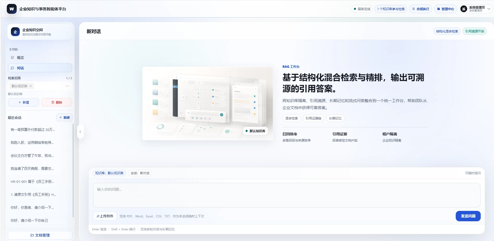 | 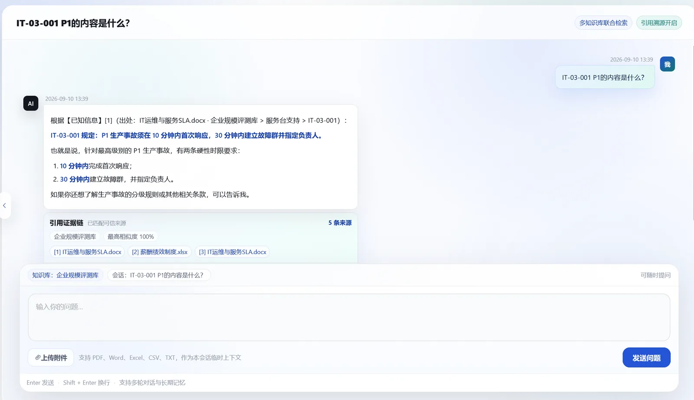 |
| 企业员工提问，支持附件与多轮追问 | 引用编号与来源区一一对应，可查看命中的知识库、文件名、片段与来源评分（排序参考） |

| 知识库治理 | 模型配置 |
| --- | --- |
| 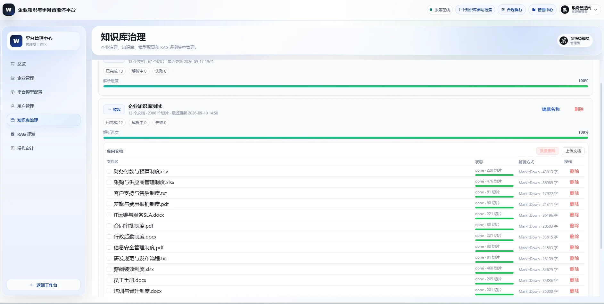 | 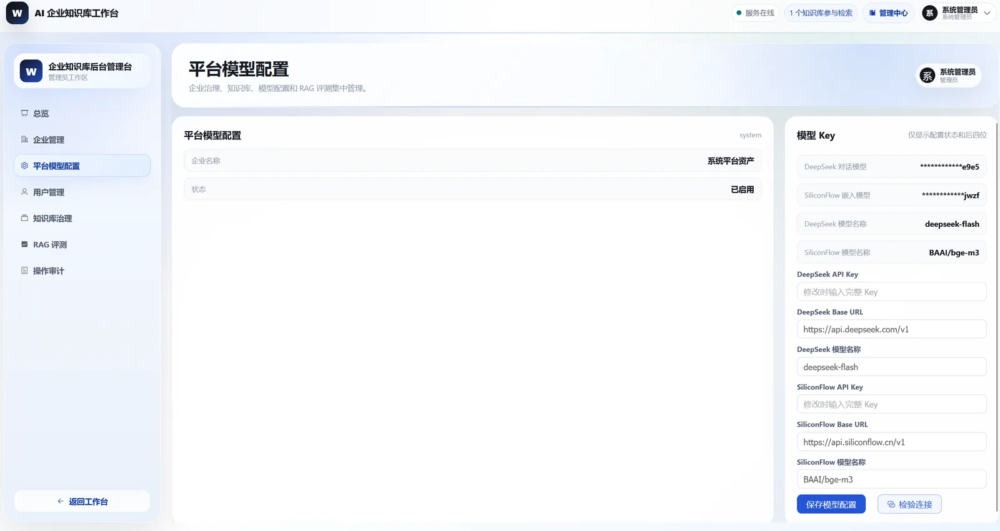 |
| 解析状态、切片数量与失败原因直接可见，支持批量删除 | Key 按企业加密保存、遮罩展示，保存与连接测试分离 |

| 会话附件 | RAG 评测中心 |
| --- | --- |
|  | 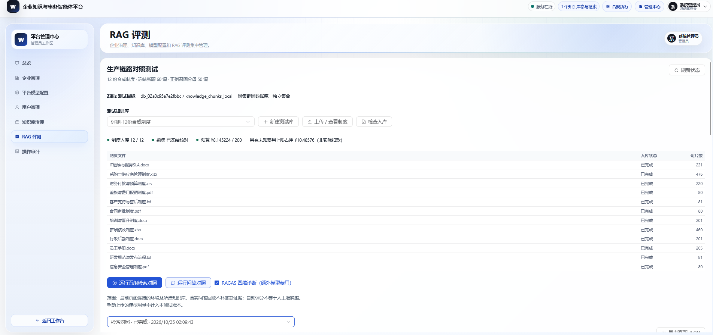 |
| 附件只在当前账号当前会话内参与回答，与知识库来源分组展示 | 题集管理、网页主评测、历史诊断与报告导出；截图为界面示意，指标以下文最新口径为准 |

| 平台企业治理 | 企业用户管理 |
| --- | --- |
| 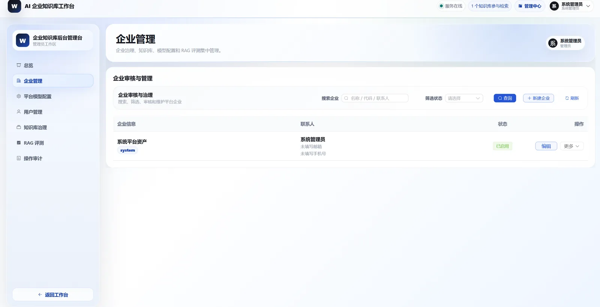 | 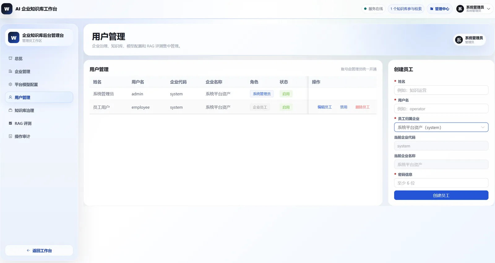 |
| 企业审核、启用禁用与软删除，治理动作全部写入审计日志 | 员工账号的创建、编辑、启停与删除，全部按企业隔离 |

| 事务工作台 | 人工审批中心 |
| --- | --- |
| 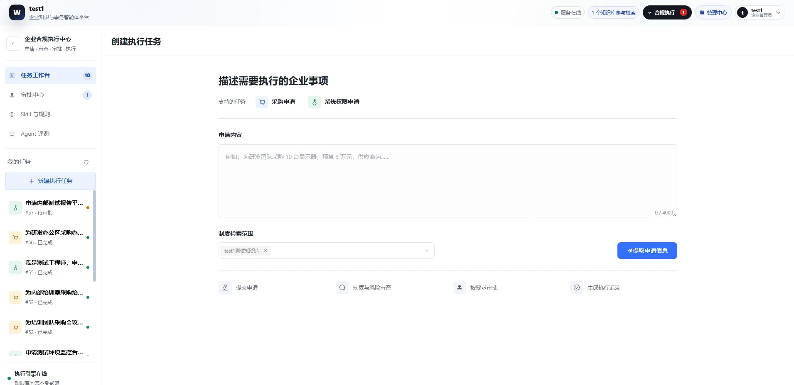 | 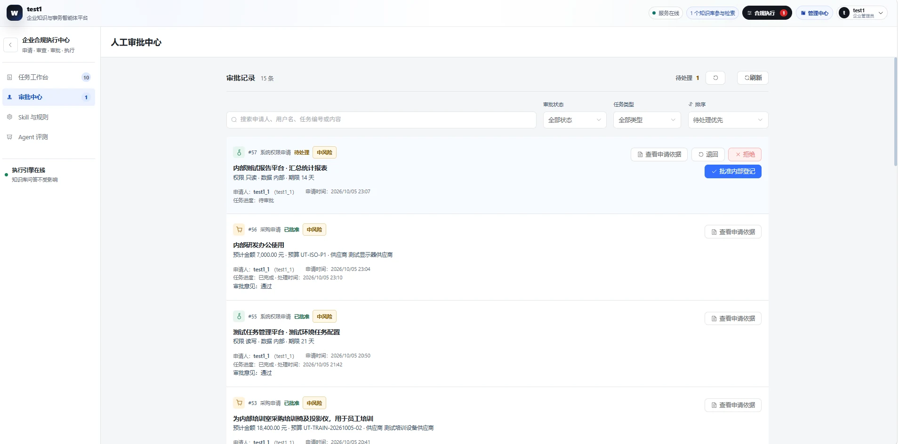 |
| 采购与权限两类申请走同一入口，先选制度检索范围，再抽取申请信息 | 待处理与历史决定分开显示；可批准登记、退回补充或拒绝，申请人本人无法自批 |

| 任务详情 · 受理与判定 | 任务详情 · 复核与登记 |
| --- | --- |
| 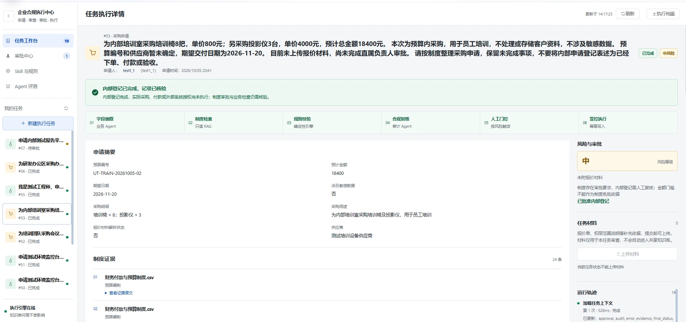 | 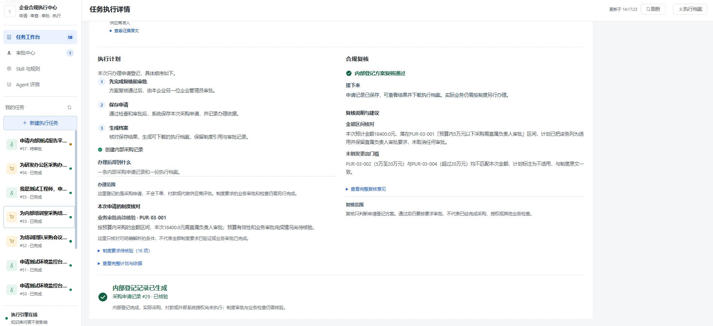 |
| 六阶段进度横向可查，下方是结构化申请字段、确定性风险与命中的制度证据 | 执行计划写明办理范围；独立复核逐项说明金额区间判定，并注明其余档位为何不适用 |

> 更多界面、检索链路与合规执行的实现说明见[项目展示页](https://jizhualiuliubei.github.io/RAG-Business-chat/)——点开是一个网页，图文介绍界面与实现，不用登录。

## 核心能力

| 能力 | 说明 |
| --- | --- |
| **多企业 SaaS** | 系统管理员、企业管理员、企业员工三类角色。企业注册、审核、启用禁用与软删除形成完整闭环，文档、会话、附件、评测任务与模型 Key 全部按企业隔离。 |
| **制度问答与引用溯源** | 用日常说法提问即可，系统检索出对应条款并生成回答，结论附 `[n]` 编号引用，能对回具体文件与片段。提示词约束资料不足时说明未知，并提供来源供核对。 |
| **知识库与文档治理** | 知识库名称在企业内唯一，不同企业可使用同名知识库，数据仍按企业隔离。支持 DOCX、PDF、扫描 PDF（OCR）、TXT、CSV、XLSX、XLS。上传后自动解析、切片、入库；解析状态、切片数量与失败原因在后台直接可见，删除文档时同步清理向量。 |
| **模型配置** | 对话模型与嵌入模型的 Key 按企业配置、加密保存、遮罩展示，支持连接测试，并按企业路由。 |
| **会话附件** | 提问时可以临时上传附件，只属于当前账号当前会话，不进入企业知识库，来源与知识库证据分组展示。 |
| **RAG 评测中心** | 网页主评测复用默认问答服务，回答保存后独立评分，支持逐题JSON导出和失败归因；网页主评测、专用检索消融、预算与环境管理仅系统管理员可操作。正式企业管理员可使用检索评测、旧规则诊断和RAGAS诊断，按企业隔离题集与任务；体验企业须先由平台开通评测权限。 |
| **合规执行** | 采购与权限申请依次经过字段提取、申请人确认、基线与模型自主补检索、计划生成、规则检查和独立复核；按风险与制度要求触发企业管理员审批，由服务端写入内部登记。支持有限反馈修订、中断恢复和运行轨迹，禁止申请人自批及跨企业代批。 |
| **审计中心** | 企业审核、状态变更、Key 更新、文档与评测删除等关键动作可追踪。 |

## 检索机制与上下文

- **授权范围内的双路召回：** 向量和字符 bigram BM25 读取同一企业、知识库及有效文档范围；多查询先批量向量化与搜索，失败时逐条回退。同一证据重复命中时保留最强原始向量支持。
- **排序与证据准入分开：** 两通道 min-max 归一化后默认按向量 0.6、BM25 0.4 加权，再做规则处理与精排，给融合高位候选保留名额。是否进入上下文另看原始支持、正文条款／章节及字面匹配，高精排分不能单独放行；未做与 RRF 的同条件对照。
- **会话级上下文：** MySQL 保存会话消息及结构化画像，历史超过默认 6 条消息时生成摘要、保留最近 2 条原文。画像属于当前会话，不自动跨会话共享；历史辅助最终生成，当前查询改写尚未基于历史完成指代消解。
- **两类执行路径：** 默认网页问答由应用组织检索并流式返回；可选工具化 RAG／MCP 具有独立接口，没有自动接入网页入口，也不与事务工具共用全部约束。

## 评测与效果验证

围绕 **12 份合成企业制度**建立评测体系，覆盖事实检索、细节解释、跨文档关联、场景计算、边界判断与信息不足六类场景。通过**五组检索消融、网页服务回放和 RAGAS 四维诊断**，分别验证查询增强、排序路径及回答质量。

### 核心优化效果

| 优化机制 | 对照基线 | 验证结果 |
| --- | --- | --- |
| **查询增强**：保留原问题，结合改写与子问题拆分 | 关闭查询增强的同配置组 | **Recall@5 提升约28%，Hit@5 提升约27%，MRR 提升约29%** |
| **精排路径**：Cross-Encoder 精排与融合高位候选保留 | 关闭精排路径的同配置组 | **MRR 提升约20%** |
| **完整 RAG 方案**：混合检索、上下文组织与生成 | 纯向量问答方案 | **RAGAS 忠实度评分提升约38%** |

以上均为同域合成制度实验中的**相对提升**，按“（完整方案－对照基线）／对照基线”计算。前两项来自同批五组检索消融，忠实度来自另一批问答对照，分别统计；精排路径的增幅对应整条排序路径。

### 生产路径验证

建立 **360 题网页服务回放主评测**，调用默认网页问答服务真实检索并流式生成，保存原回答与来源后，再由独立 **LLM-as-Judge** 从**正确性、完整性、证据支持、引用支持、拒答适当性**五维评分，并结合引用编号与可检查算式的程序校验。生成端不接收标准答案或必需引用，不按标注补证据。

**信息不足专项通过率达91.67%**，用于验证缺少实际业务记录时的合理拒答与边界说明；该结果仅对应信息不足场景。

题集包含定位提示与自然提问，来源经 AI 核对；采用固定分母，保留技术失败与逐题归因。主评测覆盖后端服务单轮回放，RAGAS 另从忠实度、事实正确性、回答相关性和上下文召回四维诊断质量。上述为内部同域合成评测，自动裁判结果不等同于人工准确率或线上用户成绩。截图用于功能演示，指标口径以本节为准。

## 快速开始

### 在线体验

**地址**：[http://118.31.45.253/](http://118.31.45.253/)

> 线上部署了**知识问答与管理**和**合规执行**两条链路；合规执行需要 Redis、Celery Worker 与 Beat，演示环境已开启，入口在顶部导航的「合规执行」。

#### 方式一（推荐）：注册体验账号，使用自己的 API Key

体验账号**免审核注册**，可使用知识库治理、文档上传、智能问答和模型配置。上传处理与问答使用你配置的模型额度，适合持续体验或测试自己的资料。

1. 登录页底部点「**企业管理员体验账号注册**」（旁边还有一条「企业管理员注册申请」，那个需要审核）
2. 填写企业名称、企业代码、管理员用户名和密码——和正式申请是同一张表单
3. **提交后无需审核**，直接用「企业代码 + 用户名 + 密码」登录；登录后先到问答工作台，再从顶部导航进「管理中心」
4. 进「**企业设置**」配置自己的对话模型与嵌入模型 API Key，检验连接后再上传资料、提问；模型调用费用由你自己的服务账号承担
5. 新建知识库、上传文档，处理完成后回到问答工作台提问，并核对回答的引用来源

**体验账号的边界**（注册弹窗里也会写明）：

| | |
| --- | --- |
| 可以使用 | 知识库建设、文档上传、智能问答、企业设置；部分后台页面可浏览，实际操作按权限开放 |
| 需要你先做 | 在「企业设置」里配置自己的对话模型与嵌入模型 API Key |
| 暂不可用 | 创建子员工账号、RAG 评测中心、合规任务创建与任务材料上传（需平台管理员开通） |
| 数量上限 | 知识库 3 个、文档 20 份 |

#### 方式二：使用公共演示账号，快速查看问答效果

公共演示账号已配置知识库和模型，适合少量提问、快速了解回答与引用效果。**该账号的模型调用费用由演示环境承担；持续使用或测试自己的资料，请优先选择方式一。**

1. 打开上面的地址，进入登录页。
2. 企业代码填 `system`，用户名填 `employee`，密码填 `employee123`，再输入算式验证码。
3. 点「登录工作台」进入问答页。
4. 提一个制度类问题，查看回答正文里的 `[1]`、`[2]` 编号及来源区；每条编号可对回知识库、文件名、片段与来源评分（排序参考）。

| 企业代码 | 用户名 | 密码 | 角色 |
| --- | --- | --- | --- |
| `system` | `employee` | `employee123` | 员工演示账号；管理中心需管理员身份 |

> 公共演示账号不能进入管理中心。需要建设自己的知识库或配置模型，请使用**方式一**；公开演示账号与数据仅用于功能体验。

#### 方式三：注册自己的企业，走一遍完整审核流程

如果你想走**正式注册**这条路（提交申请 → 平台审核 → 开通全部功能），按下面几步来：

1. **提交注册申请**：登录页底部点「企业管理员注册申请」，在弹出的表单里填写对应信息。

2. **等待审核**：提交后企业和管理员账号都处于**待审核**状态，此时还不能登录。平台管理员在「企业管理」里审核通过后，企业才会启用。

3. **登录**：用「企业代码 + 管理员用户名 + 密码」登录。所有角色登录后都先进入问答工作台；再从顶部导航进「管理中心」——里面有企业设置、知识库治理与 RAG 评测。

4. **配置模型 Key**：进「企业设置」，填入对话模型与嵌入模型的 Key，点「检验连接」确认可用。**没有配 Key 无法问答**。

5. **建设知识库**：进「知识库治理」，新建一个知识库，然后上传文档——支持 DOCX、PDF、扫描版 PDF（自动 OCR）、TXT、CSV、XLSX、XLS。上传后系统会自动解析、切片并写入向量库，页面上的解析状态和切片数量会实时更新，失败原因也会直接显示。

6. **回到问答工作台提问**：文档解析完成后，在问答页选中刚才的知识库提问，回答会带上引用来源。

7. **（可选）给同事开账号**：在「用户管理」里创建员工账号。员工登录后进入问答工作台，也能从「合规执行」提交申请；管理中心仅管理员可见。

> **方式三**的注册需要平台管理员**审核**，不会自动通过；免审核体验请使用**方式一**。

## 技术栈

**后端** FastAPI · LangChain 1.2 · LangGraph（事务链路的状态图与人工中断恢复）· SQLAlchemy · Pydantic · MCP（工具接入协议） 
**模型** DeepSeek（对话与查询改写）· BGE-M3（向量化）· bge-reranker-v2-m3（重排） 
**文档解析** Microsoft MarkItDown（主解析）· python-docx / pypdf / openpyxl（降级）· Tesseract OCR（扫描件） 
**存储与队列** Zilliz / Milvus（向量）· SQLite / MySQL（关系）· Redis 8（队列、Checkpoint、事件、租约）· Celery（长任务与定时补派发） 
**前端** Vue 3 · Element Plus · Vite

---

**▶ [在线体验](http://118.31.45.253/)**　·　**📄 [项目展示页](https://jizhualiuliubei.github.io/RAG-Business-chat/)**

在线体验：打开线上系统，体验项目功能　｜　项目展示页：查看架构、链路与评测说明

